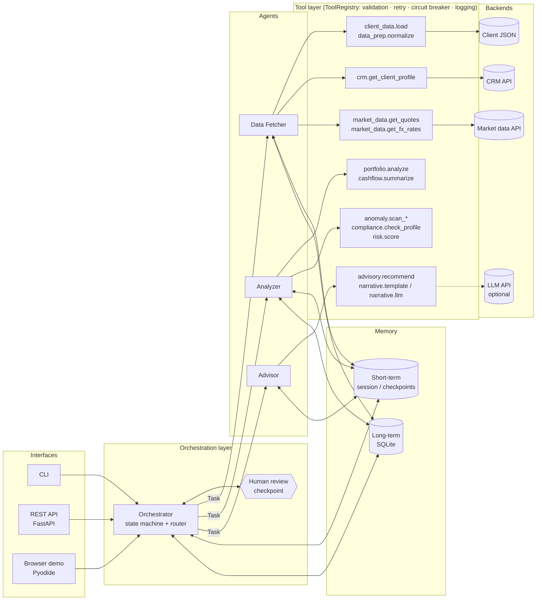
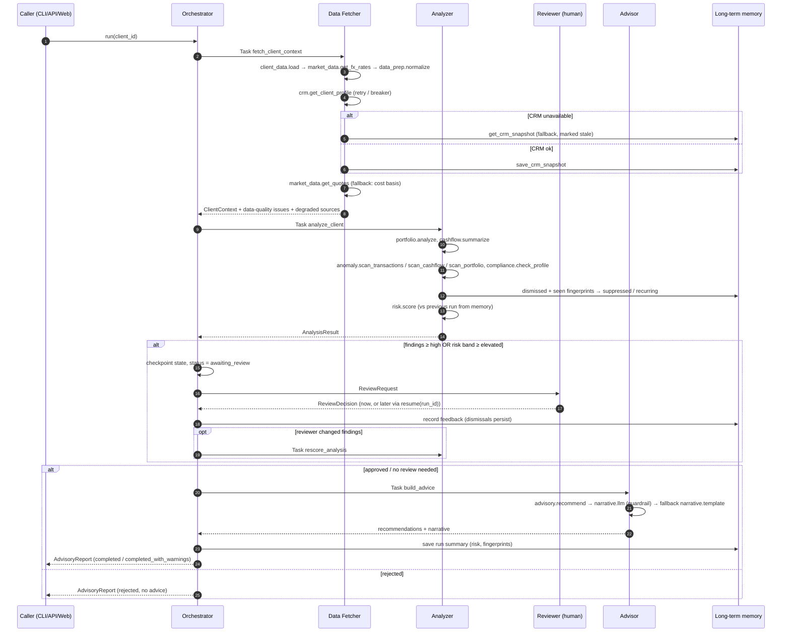

# Wealth Advisor Assistant: Multi-Agent System

A lightweight multi-agent system that ingests client financial data, enriches it through external APIs (CRM, market data), detects anomalies and risk signals, pauses for **human validation**, and produces structured, prioritised advisory output.

**▶ Live demo: https://faris-maulana.github.io/wealth-advisor-agents/**
The demo runs this repository's actual Python package in the browser (Pyodide/WebAssembly). The agents, tools, detectors, retries, circuit breakers and memory are the same code as the CLI. No backend, and no data leaves the browser.

```bash
git clone https://github.com/Faris-Maulana/wealth-advisor-agents && cd wealth-advisor-agents
python -m wealth_advisor run C002          # AML scenario with interactive human review (stdlib only, Python ≥ 3.10)
```

---

## Contents
1. [Requirements coverage](#1-requirements-coverage)
2. [Architecture](#2-architecture)
3. [Agent interactions and flow](#3-agent-interactions-and-flow)
4. [Tool abstraction](#4-tool-abstraction)
5. [Analysis and anomaly detection](#5-analysis-and-anomaly-detection)
6. [Error handling and fallbacks](#6-error-handling-and-fallbacks)
7. [Logging and observability](#7-logging-and-observability)
8. [Memory](#8-memory)
9. [Human-in-the-loop checkpoint](#9-human-in-the-loop-checkpoint)
10. [Key decisions and trade-offs](#10-key-decisions-and-trade-offs)
11. [Assumptions](#11-assumptions)
12. [Running the project](#12-running-the-project)
13. [Sample input and output](#13-sample-input-and-output)
14. [Project layout](#14-project-layout)
15. [Limitations and next steps](#15-limitations-and-next-steps)

---

## 1. Requirements coverage

| Requirement | Implementation |
|---|---|
| Orchestrator agent | `wealth_advisor/orchestrator.py`: deterministic state machine with capability-based routing, step records, pause/resume |
| ≥ 2 specialised agents | `DataFetcherAgent`, `AnalyzerAgent`, `AdvisorAgent` (`wealth_advisor/agents/`) |
| Client data (JSON) | `data/clients/C00x.json`: 5 engineered scenarios, generated deterministically by `scripts/generate_mock_data.py` |
| CRM API (mock) | `MockCRMBackend` with fault injection, plus a real `HTTPCRMBackend` (REST, tested against a local HTTP server) |
| Anomaly detection | 20 finding types in 4 families: transactions, cash-flow trends, portfolio risk, compliance (`tools/anomaly.py`) |
| Tool abstraction | `Tool` / `ToolSpec` / `ToolRegistry` / least-privilege `Toolbox` (`tools/base.py`) |
| Error handling | Typed error hierarchy, retries with backoff, circuit breakers, per-source fallbacks, failure isolation per agent, step and client |
| Logging | Structured JSON events correlated by `run_id` / `agent` / `step`, an in-memory trace per run, and decision logging |
| **Bonus:** memory | Short-term session blackboard + checkpoints; long-term SQLite store (risk history, reviewer feedback, CRM snapshots) |
| **Bonus:** HITL | Review gate between analysis and advice: confirm / dismiss / override severity / reject; sync (CLI) or async (API, web) |
| Deliverables | This README, 54 tests, sample input/output in `samples/`, CLI, REST API, Docker, browser demo |

---

## 2. Architecture



**Layers and their single responsibility**

| Layer | Knows about | Does not know about |
|---|---|---|
| Orchestrator | task types, step order, review policy, memory | which agent implements a task, any backend |
| Agents | their task, tool *names*, fallback policy for their domain | backend classes, HTTP, file paths |
| Tool registry | contracts, retries, breakers, logging | business logic |
| Tools | one capability each, typed input/output | other tools, agents |
| Backends | transport (file, HTTP, mock) | contracts and validation (owned by the tool) |
| `app.py` (composition root) | everything, and wires it once | — |

Swapping the mock CRM for a real one is a one-line change in `app.py` (`HTTPCRMBackend(base_url=...)`). No agent changes.

---

## 3. Agent interactions and flow



**Run states:** `running → awaiting_review → completed | completed_with_warnings | rejected`, or `failed` at any critical step.

**Routing.** Each agent declares `capabilities` (task types). The orchestrator dispatches `Task(type, payload)` and the router resolves the handler. A duplicate capability claim is a startup error. Adding a fourth agent (for example a Tax Agent) means registering it and adding a step. The existing agents stay untouched.

**Agent contract.** `Agent.handle()` never raises. Every outcome is an `AgentResult(status=ok|degraded|failed, output, warnings, error, duration_ms)`. Unexpected exceptions inside an agent are caught and converted to `failed`, so the orchestrator decides what a failure means.

**Step criticality**

| Step | Agent | Critical? | On failure |
|---|---|---|---|
| fetch | Data Fetcher | **yes** | Run → `failed` with a structured error |
| analyze | Analyzer | **yes** | Run → `failed` (individual detector failures only *degrade*) |
| review | Reviewer | n/a | `None` = defer (pause), reject → `rejected` |
| rescore | Analyzer | no | Keep previous score |
| advise | Advisor | no | Report still ships with analysis and an error note |

---

## 4. Tool abstraction

```python
class Tool(ABC):
    spec: ToolSpec                    # name, description, typed params, idempotent flag
    def run(self, **kwargs) -> Any    # raises ToolError subclasses only

registry.register(CRMProfileTool(backend), retry=RetryPolicy(...), breaker=CircuitBreaker(...))
toolbox = registry.scoped({"crm.get_client_profile", ...}, owner="data_fetcher")
result: ToolResult = toolbox.call("crm.get_client_profile", client_id="C002")   # never raises
```

* **Contract validation.** Arguments are checked against `ToolSpec` (unknown, missing or wrong-type parameters are rejected with `ToolInputError` before any I/O).
* **Uniform result.** `ToolResult(ok, data, error, error_type, attempts, latency_ms)`. Agents branch on `ok` / `error_type`, never on backend exceptions.
* **Least privilege.** Each agent gets a `Toolbox` with only the tools it declared. The Analyzer cannot call the CRM. A violation returns `ToolPermissionError` and is logged.
* **Cross-cutting concerns live in the registry, not the tools.** These are retries (idempotent tools only), circuit breaker, latency and attempt logging, and containment of unexpected exceptions.
* **Pure functions are tools too** (`FunctionTool`). Detectors and calculators go through the same contract and observability, and could be moved behind a service boundary without touching agents.
* **Backend/tool split.** For example, `CRMBackend` (transport: mock or `HTTPCRMBackend`) vs `CRMProfileTool` (contract: validates the payload and maps it to a typed `ClientProfile`). The HTTP backend maps 404 → `ResourceNotFoundError`, 429/5xx → `TransientToolError` and timeouts → `ToolTimeoutError`.

Registered tools: `client_data.load`, `data_prep.normalize`, `crm.get_client_profile`, `market_data.get_quotes`, `market_data.get_fx_rates`, `portfolio.analyze`, `cashflow.summarize`, `anomaly.scan_transactions`, `anomaly.scan_cashflow`, `anomaly.scan_portfolio`, `compliance.check_profile`, `risk.score`, `advisory.recommend`, `narrative.template`, `narrative.llm` (optional).

---

## 5. Analysis and anomaly detection

All thresholds live in `config.AnomalyThresholds` so they can be tuned without touching logic. Every finding carries `evidence`, a severity, a 0–1 strength score and a **stable fingerprint** (used by memory and the reviewer).

| Family | Detector | Method / rule | Severity |
|---|---|---|---|
| Transaction | `amount_outlier` | Modified z-score (median/MAD, Iglewicz–Hoaglin) per category; recurring payments excluded from baseline; min sample size | medium / high |
| | `large_outflow` | Single outflow ≥ 10% of liquid assets (and ≥ $5k) | high / critical ≥ 25% |
| | `structuring` | ≥ 3 cash deposits within 7 days in the band just under $10k | critical |
| | `duplicate_charge` | Same counterparty and amount within 10 minutes | medium |
| | `new_counterparty` | First-seen counterparty (last 30d) receiving ≥ P95 outflow | medium / high (wire or international) |
| | `unusual_geography` | Country outside CRM usual countries (or derived from history) | medium / high (wire) |
| | `velocity_burst` | ≥ 4 outbound wire/P2P transfers within 48h | medium / high (≥ 50% of liquidity) |
| Cash flow | `spending_trend` | Median discretionary spend, last 3 vs prior 3 months, ≥ +25% **and** ≥ $500/month | medium / high |
| | `income_drop` | Last 2 months vs median baseline, ≥ 30% drop | high |
| | `low_cash_buffer` | Liquid assets / median monthly spend < 3 months | medium / high (< 1) |
| Portfolio | `concentration_position` | Single name ≥ 20% (diversified funds and bond funds exempt) | medium / high ≥ 35% |
| | `concentration_sector` | Sector ≥ 40% | medium |
| | `allocation_drift` | Max asset-class deviation vs risk-profile target ≥ 10pp | medium / high ≥ 20pp |
| | `excess_volatility` | Weighted volatility > profile ceiling | medium / high ≥ 1.5× |
| Compliance | `kyc_expired` / `kyc_expiring` / `kyc_not_verified` | CRM KYC fields | high / low |
| | `risk_profile_stale` | Suitability questionnaire > 365 days old | medium |
| | `suitability_mismatch` | Implied profile from growth-asset weight is more aggressive than the stated profile | high |
| | `compliance_unverified` | No CRM data and no cache | medium |

**Alert-fatigue controls.**
1. Signals on the **same transaction are merged** into one finding, with the others listed as corroborating signals. Three or more independent signals escalate the severity by one level.
2. Single-transaction signals that belong to a multi-transaction pattern (for example a new-counterparty hit inside a velocity burst) are folded into the pattern.
3. Recurring bills are excluded from outlier baselines.
4. Reviewer dismissals are remembered and suppressed in later runs.

**Risk score.** Noisy-OR aggregation: `1 − Π(1 − w_sev · strength)`, with `w = {low .05, medium .12, high .25, critical .45}`. It is bounded, order-independent and saturating, and dismissed or suppressed findings are excluded. Bands: low < .20 ≤ moderate < .45 ≤ elevated < .70 ≤ high. The top three contributors are reported as drivers, plus the delta vs the previous run from long-term memory.

**Recommendations.** Explicit rule table: finding family → action (AML escalation, transaction verification, dispute, KYC refresh, suitability review, rebalancing proposal, emergency fund, cash-flow plan, budget review). Findings of one family collapse into a single recommendation, which links the fingerprints that triggered it. Actions with regulatory or financial consequence (escalation, trades, high-severity verification) carry `requires_approval: true`.

---

## 6. Error handling and fallbacks

| Failure | Where handled | Behaviour |
|---|---|---|
| Transient upstream error (5xx, reset) | Registry | Exponential backoff with jitter (3 attempts) |
| Timeout | Registry | Treated as transient → retried |
| Upstream down | Registry + breaker | Breaker opens after 3 consecutive failures, so later calls short-circuit (`CircuitOpenError`) instead of hammering the upstream. Half-open trial after 30s |
| 404 / bad input / contract violation | Registry | **Not retried** (retrying a deterministic failure wastes latency budget) |
| CRM unavailable | Data Fetcher | Cached CRM snapshot from long-term memory if ≤ 30 days old (`source=cache, stale=true`). Otherwise continue without a profile, and compliance reports `compliance_unverified` |
| Client missing from CRM (404) | Data Fetcher | **No cache fallback.** A missing record is an integrity issue (offboarded or merged client), and serving a cached profile could mask it |
| Market data unavailable | Data Fetcher | Holdings valued at cost basis, FX falls back to USD-only (non-USD rows dropped and reported) |
| Unknown ticker | Data Fetcher / analytics | Valued at cost basis, excluded from volatility, flagged |
| Malformed rows (missing amount, bad date, NaN, unknown currency, future-dated, duplicate id) | `data_prep.normalize` | Row dropped, issue recorded. **A bad row never blocks the run** |
| Unusable record (no client id, id mismatch, no transaction list, invalid JSON) | `client_data.load` | Critical → run `failed` with a structured error |
| A detector crashes | Analyzer | That scan is marked failed and the others still run. Step → `degraded`, run → `completed_with_warnings` |
| Agent bug | `Agent.handle` | Caught → `AgentResult(failed)`, logged with traceback |
| One client crashes in a batch | `run_batch` | Isolated, so the other clients still complete |
| LLM down / hallucinated numbers / promissory language | Advisor + guardrail | Falls back to the deterministic template narrative |

Every run ends with an explicit status, and `execution_trace` records each step's status, duration, warnings and error. The CLI exit codes are `0` ok, `1` failed, `3` awaiting review.

Fault injection (`--crm-fault`, `--market-fault`: `transient | down | slow | corrupt`) exercises each of these paths. They are also covered by tests and available as toggles in the web demo.

---

## 7. Logging and observability

* **Structured events**, not prose: `log.info("tool.attempt_failed", tool=..., attempt=2, error_type=..., will_retry=True)`.
* **Correlation** via `contextvars`: every record carries `run_id`, `client_id`, `agent` and `task`, so one grep (or one log-store query) reconstructs a run.
* **Decision logging**: agents call `self.decide("crm_fallback_cache", reason=..., snapshot_age_days=...)` at every branch point (fallbacks, skips, suppressions), so the logs explain *why* as well as *what*.
* **Sinks**: coloured console (human), JSONL file (`logs/wealth_advisor.jsonl`, machine), and a bounded in-memory `TraceRecorder` per run. The recorder backs the API's `/runs/{id}/events` and the demo's Logs tab.
* **Report-level trace**: `execution_trace` in every report (step, agent, status, ms, warnings, error).

Excerpt (`samples/output/run_log.jsonl`):
```json
{"ts":"…","level":"WARNING","logger":"wealth_advisor.tools","event":"tool.attempt_failed","run_id":"run-…","client_id":"C001","agent":"data_fetcher","task":"fetch_client_context","tool":"crm.get_client_profile","attempt":1,"error_type":"TransientToolError","error":"crm: connection refused (simulated outage)","will_retry":true}
{"ts":"…","level":"INFO","logger":"wealth_advisor.agents.data_fetcher","event":"agent.decision","run_id":"run-…","agent":"data_fetcher","decision":"crm_fallback_cache","reason":"crm: connection refused (simulated outage)","snapshot_age_days":0}
```

---

## 8. Memory

**Short-term (session).** `SessionMemory` is a per-run blackboard. Agents write `context`, `analysis` and `advice`, and the orchestrator keeps `steps`, `status` and `review_request`. All state is JSON-serialisable (`to_jsonable` / `from_dict`), which makes a paused run a **checkpoint**. `FileSessionMemory` persists it atomically (`tmp` + `rename`), so `resume` works from a different process. The CLI uses this. In production this would be Redis or Postgres with a TTL.

**Long-term.** `LongTermMemory` interface, default `SQLiteLongTermMemory` (`.state/memory.db`), with `InMemoryLongTermMemory` for tests and the browser.

| Stored | Used for |
|---|---|
| Run summaries (risk score and band, finding fingerprints, top findings) | Risk delta vs the last review, and `new` vs `recurring` labelling |
| Reviewer feedback (dismissals by fingerprint, with reviewer and note) | Suppressing confirmed false positives in future runs (still listed in the report for audit, but excluded from the risk score). A later `confirm` reverses a dismissal |
| CRM snapshots | Fallback profile during CRM outages |

Rejected runs are not written to risk history, because a reviewer has declared that analysis invalid.

---

## 9. Human-in-the-loop checkpoint

**Where:** between analysis and advice. This is the critical step: findings are validated *before* they drive recommendations, so a false positive never becomes advice.

**When:** any active finding with severity ≥ `high`, **or** risk band ≥ `elevated` (configurable: `--review-severity`, `WA_REVIEW_MIN_SEVERITY`). Clean clients (for example C005) skip the review automatically.

**Reviewer actions:** per finding, `confirm`, `dismiss` (false positive, remembered) or `override` the severity. For the whole run, `approve` or `reject`. If findings changed, the Analyzer rescores before the Advisor runs.

**Modes (strategy pattern, `hitl.py`):**

| Reviewer | Use |
|---|---|
| `CLIReviewer` | Interactive terminal (default for `run`) |
| `DeferredReviewer` | Async: run returns `awaiting_review` and is completed later by `resume` (CLI), `POST /runs/{id}/review` (API) or the web UI |
| `FileReviewer` | Decision JSON for scripted or batch runs |
| `AutoApproveReviewer` | Policy auto-approval for non-interactive batches. The decision is clearly labelled as such and recommendations still carry `requires_approval` |

---

## 10. Key decisions and trade-offs

1. **Deterministic orchestration, not an LLM planner.** The flow is a small fixed DAG, and in a regulated advisory context auditability and reproducibility matter more than flexibility. A ReAct-style planner adds cost, latency and non-determinism with no benefit for a known sequence. *Trade-off:* new workflows need code (a new step), not just a prompt. The capability router keeps that change small.
2. **The LLM is optional and only phrases; it never decides.** Detection, scoring and recommendations are deterministic and explainable. The optional LLM narrator (`WA_LLM_ENABLED=1`, any OpenAI-compatible endpoint such as a local Ollama/vLLM server or a hosted API) only rewrites a sanitised fact sheet, and its output must pass a guardrail: every number must exist in the facts, and there is no promissory language. Anything else falls back to the template. *Trade-off:* the prose is less fluent by default, but the system is free to run, works offline and is fully testable.
3. **Rules + robust statistics over ML for anomaly detection.** With about 6 months of data per client there is nothing meaningful to train on, and compliance needs reasons. Modified z-scores (median/MAD) resist the very outliers they hunt. *Trade-off:* hand-set thresholds can miss novel patterns. With labelled history, the reviewer feedback collected in memory is exactly the training signal for a supervised model (for example a gradient-boosted classifier) or for per-client threshold calibration.
4. **Fewer, better alerts.** Correlated-signal merging, pattern folding, recurring-payment exclusion and remembered dismissals all reduce volume. *Trade-off:* merging hides some individual signals in the headline, so they are kept as `corroborating_signals` in the evidence.
5. **HITL before advice, not after.** Reviewing raw findings is cheaper and safer than reviewing finished recommendations, and reviewer feedback becomes structured data (fingerprints) instead of free text.
6. **Degrade, don't die.** Only the client record is critical. Everything else has a documented fallback, and the report states exactly what was degraded (`degraded_sources`, `data_quality`, `analysis_notes`).
7. **No cache fallback on CRM 404** (see §6). A deliberate asymmetry: an outage is a reason to use cached data, but a missing record is not.
8. **Standard library only for the core.** No runtime dependencies, so it is trivial to run, has no supply-chain surface, and the same code runs in the browser via Pyodide (that is how the live demo works without a backend). FastAPI is an optional extra. *Trade-off:* I hand-wrote small pieces (retry, breaker, dataclass (de)serialisation) that libraries like `tenacity` or `pydantic` would provide.
9. **Synchronous execution.** The agents are sequential by data dependency, and the only parallelisable work (CRM and market-data fetches) is I/O that is milliseconds against mocks. *Trade-off:* against real APIs, `asyncio.gather` in the Data Fetcher would cut fetch latency to roughly the slowest call. The tool contract would not change.
10. **Noisy-OR risk score.** It is interpretable and bounded, but assumes independent signals, which is why correlated signals are merged *before* scoring.
11. **Volatility estimate assumes perfect correlation** (a weighted average of single-asset volatilities). This is a conservative upper bound, chosen because we have no covariance data, and it is labelled as such in the output.

---

## 11. Assumptions

* Base currency is USD. Non-USD transactions are converted with the mock FX table, and unknown currencies are dropped and reported.
* Amount sign convention: negative = outflow, positive = inflow. `investment_transfer` / `internal_transfer` are the client's own money moving and are excluded from spend statistics.
* "Liquid assets" = checking + savings. The investable portfolio = holdings + brokerage cash.
* Diversified funds and bond funds are exempt from single-name concentration limits.
* Risk-profile targets (conservative / moderate / aggressive) are illustrative house-view allocations in `config.RISK_PROFILE_TARGETS`.
* The $10,000 structuring threshold mirrors the US currency-transaction-reporting threshold. Jurisdiction-specific thresholds would be configuration.
* Data is a 6-month window ending `as_of` (2026-09-30). Trend detectors need ≥ 4 months.
* The mock CRM's usual-countries list is authoritative when present. Otherwise usual countries are derived from history (≥ 3 transactions) plus the home country.
* A cached CRM profile older than 30 days is not trusted.
* Mock data is synthetic and deterministic (seeded). No real client data is used.

---

## 12. Running the project

**Requirements:** Python ≥ 3.10. The core has **no third-party dependencies**.

```bash
python -m wealth_advisor clients                       # list sample clients
python -m wealth_advisor run C002                      # interactive human review (AML scenario)
python -m wealth_advisor run --all --review auto       # batch, policy auto-approval
python -m wealth_advisor run C001 --review defer       # pause at the checkpoint (exit code 3)
python -m wealth_advisor pending                       # list runs awaiting review
python -m wealth_advisor resume <run_id> --decision samples/output/hitl_flow/2_review_decision.json
python -m wealth_advisor history C002                  # long-term memory for a client

# failure injection
python -m wealth_advisor run C001 --review auto --crm-fault down --market-fault transient
```

Reports are written to `output/<client>_<run_id>.json` (machine) and `.md` (human), logs to `logs/wealth_advisor.jsonl`, and state to `.state/`.

**Tests, API, Docker, demo**
```bash
pip install -e ".[dev,api]"
pytest                                   # 54 tests: tools, detectors, orchestrator flows, memory, CLI, API
uvicorn wealth_advisor.api:app --reload  # http://localhost:8000/docs
docker build -t wealth-advisor . && docker run -p 8000:8000 wealth-advisor
python scripts/build_site.py             # rebuild the static browser demo into site/
python scripts/generate_mock_data.py     # regenerate deterministic mock data
```
A `Makefile` wraps these (`make test`, `make demo`, `make batch`, `make api`, `make site`).

**REST API**

| Method | Path | Purpose |
|---|---|---|
| `GET` | `/health` | Registered tools and circuit-breaker states |
| `GET` | `/clients` | Available clients |
| `POST` | `/runs` | `{"client_id": "C002", "crm_fault": "none", "market_fault": "none"}` → report (may be `awaiting_review`) |
| `GET` | `/runs/{run_id}` | Status, report and pending review request |
| `GET` | `/runs/{run_id}/events` | Structured event trace |
| `POST` | `/runs/{run_id}/review` | Submit a `ReviewDecision` → resumed report (`409` if not awaiting review) |
| `GET` | `/clients/{id}/history` | Long-term memory |

**Optional LLM narrative:** any OpenAI-compatible `/chat/completions` endpoint.
```bash
export WA_LLM_ENABLED=1                          # default endpoint: local Ollama
export WA_LLM_BASE_URL=http://localhost:11434/v1  # or a vLLM server / hosted provider
export WA_LLM_MODEL=qwen2.5:7b-instruct
export WA_LLM_API_KEY=...                         # only if the endpoint requires it
```
Without it, the deterministic template is used. If the endpoint is unreachable or its output fails the guardrail, the system falls back to the template.

---

## 13. Sample input and output

**Inputs** (`data/`):

| Client | Scenario | Expected behaviour |
|---|---|---|
| C001 Amelia Chen | NVDA/AAPL concentration, equity drift, rising discretionary spend, $18.5k tuition wire | Portfolio and suitability findings → rebalancing proposal |
| C002 Robert Lindqvist | 4 cash deposits $9.4–9.9k in 5 days, $48k wire to a new Cyprus counterparty, duplicate pharmacy charge, KYC expired | Critical AML findings → HITL → compliance escalation |
| C003 Priya Nair | Salary stops, 5 P2P transfers in 28h, 1.2-month cash buffer, aggressive portfolio vs moderate profile | Income shock, velocity burst, suitability mismatch |
| C004 Marcus Oyelaran | Missing/NaN amounts, invalid date, EUR/SGD/unknown currency, duplicate ids, negative quantity, unknown ticker, absent from CRM | Processed with 9 data-quality issues, `completed_with_warnings` |
| C005 Sofia Marquez | Clean, well-diversified | No findings, no review, `completed` |
| C999 | No data file | Graceful `failed` with a structured error |

Input record shape (`data/clients/C002.json`, abbreviated):
```json
{
  "client_id": "C002", "name": "Robert Lindqvist", "as_of": "2026-09-30", "base_currency": "USD",
  "accounts": [{"account_id": "C002-CHK", "type": "checking", "balance": 31200.0}],
  "holdings": [{"ticker": "BND", "quantity": 3200, "cost_basis": 236000}],
  "transactions": [{"txn_id": "C002-T0128", "timestamp": "2026-09-16T15:42:00", "amount": -48000.0,
                    "currency": "USD", "category": "transfer_out", "counterparty": "Meridian Holdings Ltd",
                    "channel": "wire", "country": "CY", "account_id": "C002-CHK"}]
}
```

**Outputs** (`samples/output/`):
* `C00x_<run>.json` / `.md`: one report per scenario.
* `hitl_flow/`: the full asynchronous review cycle for C002. `1_paused` (awaiting review) → `2_review_decision.json` → `3_resumed` (completed, with the duplicate charge dismissed and the severity override applied) → `4_next_run_memory` (the dismissed finding is now `suppressed`, the others are `recurring`, and there is a risk delta vs the previous run).
* `degraded_crm_down_cache_fallback/`: CRM outage served from the cached snapshot.
* `run_log.jsonl`: structured logs for all of the above.

Output excerpt (C002 after review):
```json
{
  "status": "completed",
  "risk": { "value": 0.7476, "band": "high",
            "drivers": ["Large outflow: $48,000 to Meridian Holdings Ltd (critical)",
                        "Possible structuring: 4 cash deposits just under $10,000 (critical)",
                        "KYC expired 46 days ago (high)"] },
  "anomalies": [{
      "type": "structuring", "category": "transaction", "severity": "critical", "score": 0.9,
      "title": "Possible structuring: 4 cash deposits just under $10,000",
      "evidence": {"total": 38600.0, "amounts": [9500.0, 9800.0, 9400.0, 9900.0],
                   "first": "2026-09-09T10:15:00", "last": "2026-09-14T13:15:00"},
      "transaction_ids": ["C002-T0124", "C002-T0125", "C002-T0126", "C002-T0127"],
      "fingerprint": "aeae4e8cc7571d49", "status": "confirmed" }],
  "recommendations": [{
      "id": "R1", "priority": "P1", "category": "compliance",
      "action": "Escalate to the compliance/AML officer for review and possible suspicious-activity filing. Do not discuss the escalation with the client (tipping-off risk).",
      "linked_findings": ["aeae4e8cc7571d49"], "requires_approval": true }],
  "narrative": "Robert's overall risk is HIGH (score 75/100). Key findings: …",
  "review": { "required": true, "decision": { "approved": true, "reviewer": "j.whitfield", "…": "…" } },
  "execution_trace": [
      {"step": "fetch", "agent": "data_fetcher", "status": "ok", "duration_ms": 4.84},
      {"step": "analyze", "agent": "analyzer", "status": "ok", "duration_ms": 2.26},
      {"step": "rescore", "agent": "analyzer", "status": "ok", "duration_ms": 0.97},
      {"step": "advise", "agent": "advisor", "status": "ok", "duration_ms": 0.85}]
}
```

---

## 14. Project layout

```
wealth_advisor/
  orchestrator.py        Orchestrator: state machine, capability router, review gate, pause/resume
  agents/                base.py (contract) · data_fetcher.py · analyzer.py · advisor.py
  tools/
    base.py              Tool, ToolSpec, ToolRegistry, Toolbox, ToolResult
    resilience.py        RetryPolicy, CircuitBreaker
    faults.py            Fault injection for mock backends
    client_data.py       Data source, loader, normaliser/validator
    crm.py               CRM backends (mock, HTTP) + profile tool
    market_data.py       Quotes and FX tools
    analytics.py         Portfolio and cash-flow analytics
    anomaly.py           Detectors, correlation merging
    scoring.py           Risk score
    advisory.py          Recommendation rules
    narrative.py         Template / LLM narrators + guardrail
  memory/                short_term.py (session, checkpoints) · long_term.py (SQLite / in-memory)
  hitl.py                Reviewer strategies
  models.py              Typed dataclasses + JSON (de)serialisation
  logging_setup.py       Structured logging, context correlation, trace recorder
  config.py              Settings and all thresholds
  app.py                 Composition root
  cli.py · api.py        Interfaces
web/                     Browser demo (template + Pyodide bridge)
scripts/                 Mock-data generator, site builder
data/                    Mock client data, CRM DB, market data
samples/output/          Generated sample reports and logs
tests/                   54 tests
```

---

## 15. Limitations and next steps

* **Calibration.** Thresholds are sensible defaults, not fitted. Next step: use stored reviewer feedback (dismiss vs confirm per detector) to measure per-detector precision, then tune thresholds, or train a ranker once there is enough labelled history.
* **Concurrency.** Fetches are sequential. Moving to `asyncio` in the Data Fetcher would parallelise the CRM and market-data calls.
* **Persistence and multi-tenancy.** SQLite and file checkpoints are single-node. Production needs Postgres or Redis, plus row-level access control per advisor.
* **Security.** The API has no authentication (demo scope). Production needs OIDC, per-advisor authorisation, PII minimisation in logs (only ids and amounts are logged today), and an audit trail of reviewer decisions (currently stored in memory and logs).
* **Observability.** Events are OpenTelemetry-ready in shape (run, agent and tool spans). Exporting traces and metrics (retry rate, breaker opens, false-positive rate per detector) is the next step.
* **Covariance-aware risk.** Replace the ρ = 1 volatility bound with a covariance matrix from market data.
